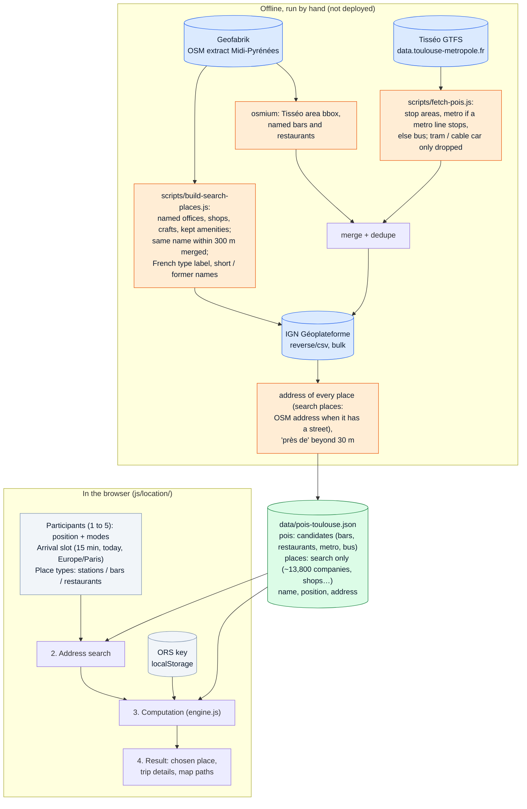
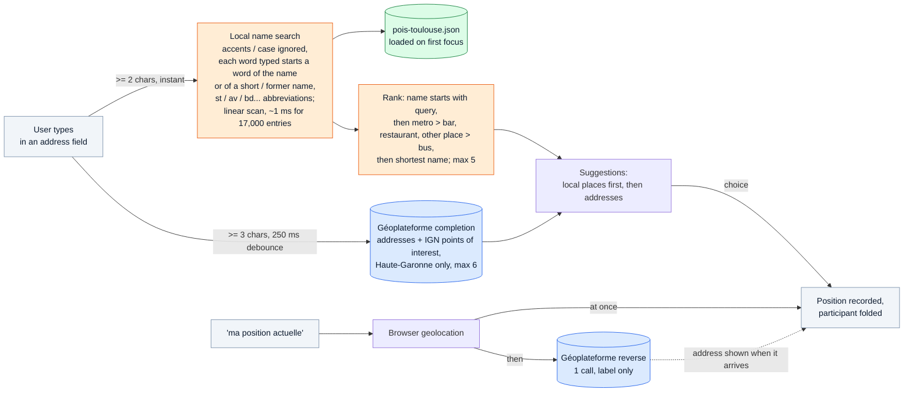
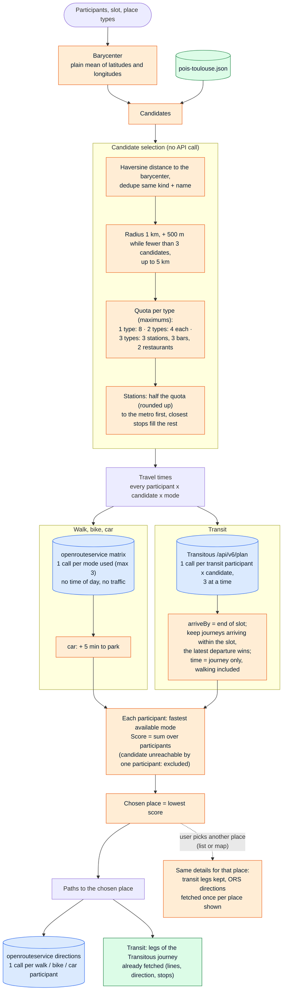
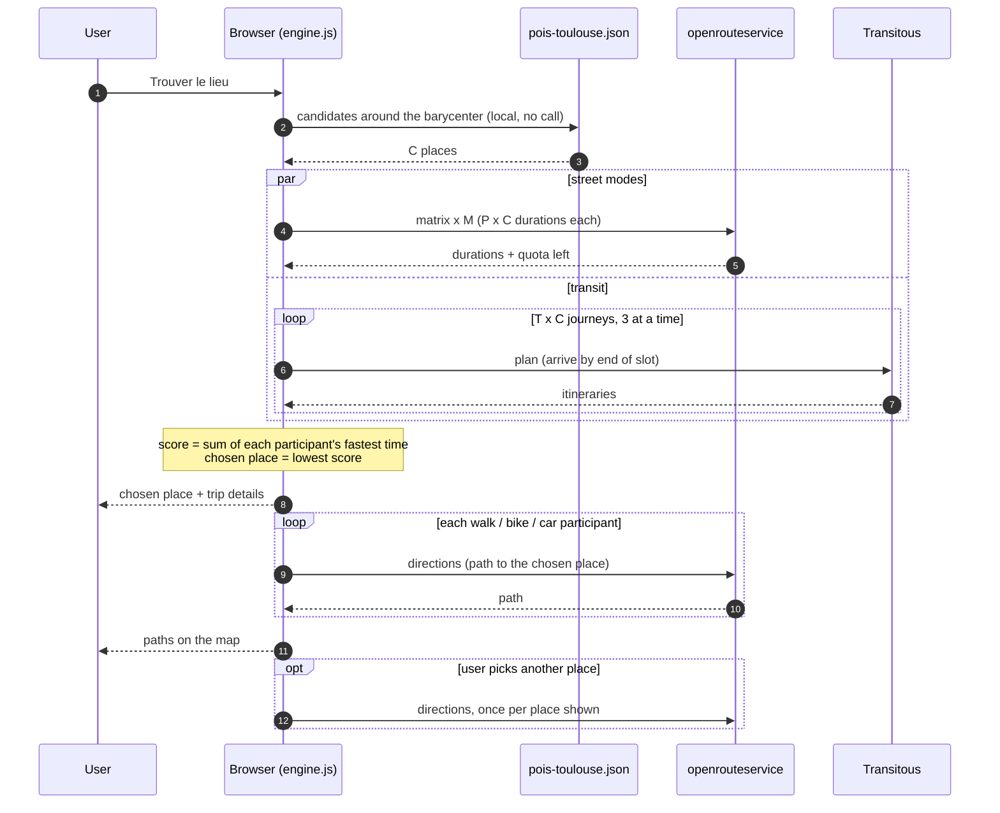

# Location — processing pipeline

How the meeting point finder (`location.html`, `js/location/`) turns participants into a
chosen place. Everything runs in the browser: Vercel only serves static files, and the
only key (openrouteservice) is the user's own, kept in `localStorage`.

The diagrams are [Mermaid](https://mermaid.js.org/) code: GitHub renders them, and any
Mermaid editor (e.g. https://mermaid.live) can display or export them.

Legend used in the diagrams:

- **blue**: external API call (network, counted in the page's "Appels API" panel)
- **green**: local data (`data/pois-toulouse.json`, served with the site, no API call)
- **orange**: algorithm choice
- **grey**: browser storage or user input

## 1. Overview

## 2. Address search (main.js)

## 3. Computation (engine.js)

## 4. API calls of one computation

With `P` participants (at most 5), `C` candidates (at most 8), `M` street modes used by
someone (at most 3) and `T` participants who may take transit:

| Service | Calls per computation | Limit |
|---|---|---|
| openrouteservice matrix | `M` ≤ 3 | 50 / day (free plan) |
| openrouteservice directions | ≤ `P` for the chosen place, + ≤ `P` per other place shown | 200 / day (free plan) |
| Transitous plan | `T` × `C` ≤ 40 | > 720 / 24 h: coordinate with Transitous |
| Géoplateforme completion | 1 per pause while typing (≥ 3 chars) | none stated |
| Géoplateforme reverse | 1 per "ma position actuelle" | none stated |
| Local data | 0 (one static file, loaded once) | — |

## 5. Data sources and licences

| Data | Source | Licence / policy |
|---|---|---|
| Bars, restaurants | OpenStreetMap via Geofabrik, extract of 2026-10-26 | ODbL |
| Search-only places (companies, shops, schools…) | OpenStreetMap via Geofabrik, extract of 2026-10-28 | ODbL |
| Metro stations, bus stops | Tisséo GTFS, 2026-10-27 | ODbL |
| Place addresses | IGN Géoplateforme (Base Adresse Nationale), 2026-10-27 and 2026-10-28 (search places) | Licence Ouverte |
| Transit journeys | Transitous (networks' open GTFS) | open-source, non-commercial, light use |
| Walk, bike, car | openrouteservice | free plan, user's own key |
| Map tiles | OpenStreetMap | tile usage policy |
