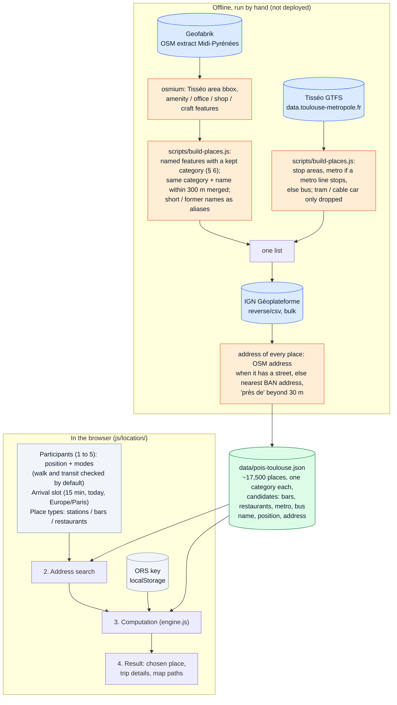
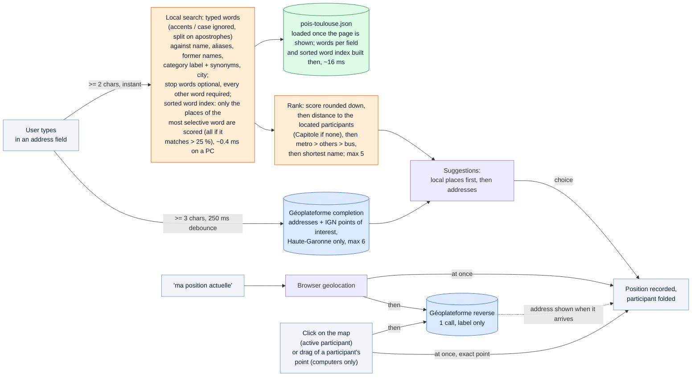
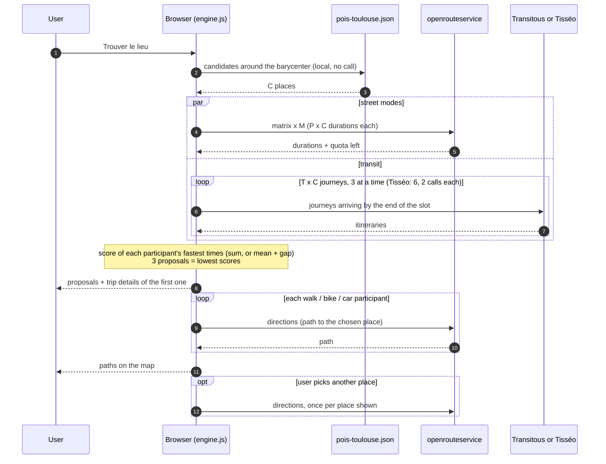

# Location — processing pipeline

How the meeting point finder (`rendez-vous.html`, page called "Rendez-vous"; code in `js/location/`) turns participants into a
ranked list of places. Everything runs in the browser: Vercel only serves static files, and the
keys (openrouteservice, needed only when a participant walks, cycles or drives; Tisséo, optional) are the user's own, kept in `localStorage`
(key `location.apiKeys`), like the settings (`location.settings`: view, score, number of candidates, transit engine).

Participants have no name field (removed 2026-10-29): they are "participant 1, 2…", with a color each,
shown as a disc in their color with their number (the label is kept for screen readers).

Two views, picked in "Réglages" (`location--demo` class on the layout, CSS only, no new computation):

- **pratique** (default): one progress bar; the map shows the participants and the 3 proposals;
  each participant's trip is one line (mode, time, lines taken), the steps folded under
  "Voir l'itinéraire" (each person usually follows their own navigation app to the shared address);
- **démonstrateur**: the computation steps and the "Appels API" panel; the map also shows the
  barycenter and every other candidate; the results add a list of every candidate with its score,
  and the trips' steps are shown unfolded.

The diagrams are [Mermaid](https://mermaid.js.org/) code: GitHub renders them, and any
Mermaid editor (e.g. https://mermaid.live) can display or export them.

Legend used in the diagrams:

- **blue**: external API call (network, counted in the page's "Appels API" panel)
- **green**: local data (`data/pois-toulouse.json`, served with the site, no API call)
- **orange**: algorithm choice
- **grey**: browser storage or user input

## 1. Overview

## 2. Address search (search.js, main.js)

Placing on the map: the *active* participant (highlighted card, named above the map) is the one
whose card was focused or touched last; at load, the first one. Once it is placed, by a suggestion,
"ma position actuelle" or the map, the next participant without a position becomes active, none if
all are placed, and none once the computation starts, so that a click on the result map moves
nobody. A single click waits 300 ms: a double click (or double tap) only zooms. Clicks on the
participants', candidates' and barycenter's points do not reach the map. On computers
(`pointer: fine`), a participant's point can be dragged (by hand, Leaflet only drags image
markers); not on touch screens, where it would fight with panning. The map does not recenter
after a map placement.

Score of a place (constants at the top of `search.js`, starting values to tune):

- each typed word keeps its best match over all fields: quality × field weight;
- quality: whole word 3 (also for an abbreviation: `st` = `saint`), start of a word 2;
- weight: name 1, alias 0.8, category label or synonym 0.6, city 0.6, former name 0.3;
- + 2 when the name starts with the whole query, + 1 when every required word matches in the name;
- stop words (le, la, les, l, de, du, des, d, au, aux) add their match but may match nothing,
  unless the query has only stop words.

Sorted word index: every distinct word of every field (~11,300) with the places that have it,
built in the browser right after the data file. Shipping it precomputed would add ~100 KB
(brotli) to download, slower than building it below ~16 Mbit/s. A typed word finds its places by
binary search; only the places of the most selective required word are scored. Same results as
a scan of every place (checked on 830 queries); ~0.4 ms per keystroke on average on a PC instead
of ~3 ms, and never slower: a very common prefix (one letter, "to" for Toulouse) falls back to the scan.

## 3. Computation (engine.js)

```mermaid
flowchart TB
    classDef api fill:#DBEAFE,stroke:#2563EB,color:#0C1A2E
    classDef local fill:#DCFCE7,stroke:#15803D,color:#0C1A2E
    classDef algo fill:#FFEDD5,stroke:#EA580C,color:#0C1A2E

    START(["Participants, slot, place types"]) --> CENTER["Barycenter<br/>plain mean of latitudes and longitudes"]:::algo
    CENTER --> CAND["Candidates"]:::algo
    DATA[("pois-toulouse.json")]:::local --> CAND

    subgraph CANDIDATES["Candidate selection (no API call)"]
        direction TB
        R0["Only the candidate categories:<br/>amenity=bar, amenity=restaurant, metro, bus"]:::algo
        R1["Haversine distance to the barycenter,<br/>dedupe same category + name"]:::algo
        R2["Radius 1 km, + 500 m while fewer than 3 candidates<br/>(or than the number set, if lower), up to 5 km"]:::algo
        R3["Quota per type (maximums): the number of<br/>candidates set in the page (1 to 8, default 8)<br/>split evenly, first types first:<br/>8 over 3 types: 3 stations, 3 bars, 2 restaurants"]:::algo
        R4["Stations: half the quota (rounded up)<br/>to the metro first, closest stops fill the rest"]:::algo
        R0 --> R1 --> R2 --> R3 --> R4
    end
    CAND --> CANDIDATES

    CANDIDATES --> TIMES["Travel times<br/>every participant x candidate x mode"]

    subgraph STREET["Walk, bike, car"]
        MATRIX[("openrouteservice matrix<br/>1 call per mode used (max 3)<br/>no time of day, no traffic")]:::api
        PARK["car: + 5 min to park"]:::algo
        MATRIX --> PARK
    end

    subgraph TRANSIT["Transit (engine picked in the page)"]
        PLAN[("Transitous /api/v6/plan (default)<br/>1 call per transit participant x candidate,<br/>3 at a time; arriveBy = end of slot;<br/>maxItineraries=5, detailedTransfers=false")]:::api
        TISSEO[("Tisséo /v2/journeys.xml (user's key)<br/>2 calls per participant x candidate, 6 at a time:<br/>4 journeys leaving 1 h before the end of the slot,<br/>then 4 leaving (shortest travel time + 10 min) before it")]:::api
        WINDOW["keep journeys arriving by the end of the slot;<br/>time = journey + wait until the slot starts<br/>when arriving early (walking included);<br/>shortest time wins, then latest departure"]:::algo
        RETRY["technical failure: 1 retry after 2 s;<br/>failing twice = journey failed,<br/>its candidate is 'incomplete'"]:::algo
        WINDOW --- RETRY
        PLAN --> WINDOW
        TISSEO --> WINDOW
    end

    TIMES --> STREET
    TIMES --> TRANSIT
    PARK --> SCORE
    WINDOW --> SCORE

    SCORE["Each participant: fastest available mode<br/>Score (Réglages, rankCandidates):<br/>temps total = sum of the times, or<br/>moyenne + écart = mean + (longest - shortest)<br/>(candidate unreachable by one participant: excluded)"]:::algo
    SCORE --> BEST["Ranking: lowest score first, equal scores by lower total;<br/>complete candidates only (incomplete ones only if no complete<br/>one is reachable); the first 3 are the proposals, the first one<br/>is shown; changing the score re-ranks without any call"]:::algo

    BEST --> ROUTES["Paths to the chosen place"]
    ROUTES --> DIRECTIONS[("openrouteservice directions<br/>1 call per walk / bike / car participant")]:::api
    ROUTES --> LEGS["Transit: legs of the journey already fetched<br/>(lines, direction; stops count with Transitous only)"]:::local

    BEST -.->|"user picks another proposal<br/>(button or map; demonstrator: any candidate)"| OTHER["Same details for that place:<br/>transit legs kept, ORS directions<br/>fetched once per place shown"]:::algo
```

## 4. API calls of one computation

With `P` participants (at most 5), `C` candidates (at most 8), `M` street modes used by
someone (at most 3) and `T` participants who may take transit:

| Service | Calls per computation | Limit |
|---|---|---|
| openrouteservice matrix | `M` ≤ 3 | 50 / day (free plan) |
| openrouteservice directions | ≤ `P` for the chosen place, + ≤ `P` per other place shown | 200 / day (free plan) |
| Transitous plan | `T` × `C` ≤ 40 | > 720 / 24 h: coordinate with Transitous |
| Tisséo journeys (instead of Transitous) | 2 × `T` × `C` ≤ 80 | per key, monitored by Tisséo; paid beyond thresholds if they ever set some |
| Géoplateforme completion | 1 per pause while typing (≥ 3 chars) | none stated |
| Géoplateforme reverse | 1 per "ma position actuelle", map click or drag of a point | none stated |
| Local data | 0 (one static file, loaded once) | — |

Links of the chosen place (no call until followed): its OpenStreetMap page (`openstreetmap.org/node/…`
for an OSM feature, a marker at its position for a Tisséo stop) and a Google Maps search (name and
address, so that Google shows the place's own page; position for a stop). "Partager le lieu" sends
name, address, slot and the OpenStreetMap link to the system share sheet (`navigator.share`), or
copies them to the clipboard where there is none (most computers).

Transitous answer size (measured 2026-10-28 on 12 trips, 18:00–18:15 slot): by default `/plan`
returns up to ~14 journeys over 2 h with turn-by-turn walking steps, ~400 KB raw (~100 KB gzip) per
call. `maxItineraries=5&detailedTransfers=false` halves it and kept the same best journey on 11/12
trips (one 1 min longer); no field the page uses is lost (geometry, stops, lines, colors).
`timetableView=false` would be ~8x lighter but returns only the latest-arriving journey, worse on
7/12 trips (up to +14 min) since it drops faster journeys arriving early.

openrouteservice note (checked 2026-10-28): a refused key gets a 403 without CORS headers, so the
browser only sees a network error; the page then says "openrouteservice injoignable, clé refusée ou
quota dépassé" (an exceeded quota, 429, probably looks the same; not checked).

Tisséo API notes (checked 2026-10-28): CORS headers only on XML answers (none on JSON), hence
`journeys.xml` read with `DOMParser`; a refused key answers 403 without CORS headers, so the
browser only sees a network error, like a passing network failure: it is tried again once, and a
second network error stops the computation as a refused key (an explicit 401/403 stops it at once);
no arrival-time search, hence the two calls; Tisséo network
only (no TER, no liO coaches); it gives no count of stops travelled.

## 5. Data sources and licences

| Data | Source | Licence / policy |
|---|---|---|
| Bars, restaurants, companies, shops, schools… | OpenStreetMap via Geofabrik, data of 2026-10-27 | ODbL |
| Metro stations, bus stops | Tisséo GTFS, 2026-10-28 | ODbL |
| Place addresses | OpenStreetMap, else IGN Géoplateforme (Base Adresse Nationale), 2026-10-28 | ODbL / Licence Ouverte |
| Transit journeys | Transitous (networks' open GTFS) | open-source, non-commercial, light use |
| Transit journeys (optional) | Tisséo API v2, with the visitor's own key | ODbL; a key in a web page is accepted by Tisséo (developer documentation § 2.7) |
| Walk, bike, car | openrouteservice | free plan, user's own key |
| Map tiles | OpenStreetMap | tile usage policy |

## 6. Place categories

To rebuild the file from scratch (OSM download, osmium, Tisséo GTFS, addresses, every
post-processing step below): `scripts/regenerate-places.sh` (needs curl, osmium-tool, node,
unzip; `--pbf` reuses an extract already downloaded). About 30 s plus the ~360 MB download.

Every place of `data/pois-toulouse.json` has exactly one `category` code; the French label of
each code is in the file's `categories` table. The code depends on where the place comes from
(`scripts/build-places.js`, "CATEGORY RULES"):

| Source | How the code is set | Examples |
|---|---|---|
| Tisséo GTFS stop area | `metro` if at least one metro trip stops at one of its stop points, else `bus` if a bus trip does; stop areas served only by tram or cable car are left out | `metro`, `bus` |
| OpenStreetMap feature with a `name` | the first tag present among `amenity`, `office`, `shop`, `craft` (in this order) that is kept, written `key=value` | `amenity=bar`, `office=company`, `shop=bakery` |

OSM tags kept:

- `amenity`: only a listed set of values people look for by name (bar, restaurant, school,
  pharmacy, bank, café, town hall, cinema…); benches, lockers, chargers… are dropped, and the
  next key is tried.
- `office`, `shop`, `craft`: every value except `shop=vacant`.

Labels: a listed code gets its own label (`office=company` → "entreprise"); an unlisted
`office`, `shop` or `craft` value gets the key's label ("bureau", "commerce", "artisan").
The code always keeps the precise OSM tag, so a label can be refined later without
regenerating the file's codes.

Candidates: the engine only picks `amenity=bar`, `amenity=restaurant`, `metro` and `bus`
places (`CATEGORIES` in `engine.js`); every other place is for the address search only. Only
candidates keep their OSM or GTFS `id` (the engine keys its route cache with it); the ids of
the other places would weigh a quarter of the file.

Duplicates: within one source, the same name (accents and case ignored) closer than 300 m is
one place, whatever its categories: it takes the category first in the order bar, restaurant,
metro, bus, other amenities, office, shop, craft, and the position and address of its best
described feature (an address, then a node rather than a building). An OSM `amenity=bus_station`
named like a Tisséo stop area within 300 m is that stop area and is dropped. Other OSM places
named like a nearby stop (a school, a church, a clinic) stay apart: the stop is named after them.

Fields (generation normalizes them, the browser only reads them):

| Field | Presence | Content |
|---|---|---|
| `id` | candidates only | OSM `node/…`, `way/…`, `relation/…` or Tisséo `stop_area:…` |
| `category` | always | code, see above |
| `name` | always | as written in OSM or the GTFS, trimmed only (capitals are often real acronyms) |
| `lat`, `lon` | always | node, mean of a building's outer ring, or stop area position; 5 decimals |
| `street` | ~17,200 | house number and street, street type capitalized |
| `postcode`, `city` | all but 2 | commune in its BAN spelling, without CEDEX; CEDEX or missing OSM postcodes replaced by the BAN one |
| `addrSrc` | with an address | `osm`: the place's own OSM street; `ban`: the nearest BAN address (bulk reverse geocoder), or, when none is found, only the postcode and city of the nearest one within 500 m (no street) |
| `near` | some `ban` | the BAN address is more than 30 m away ("près de") |
| `aliases` | ~700 | OSM `short_name`, `alt_name`, `official_name` (split on `;`) |
| `oldNames` | ~140 | OSM `old_name`, kept apart: it sometimes names the previous business at the address |
